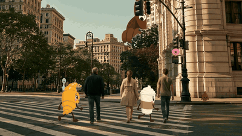
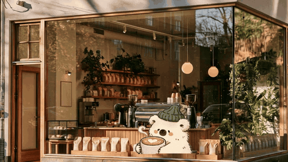
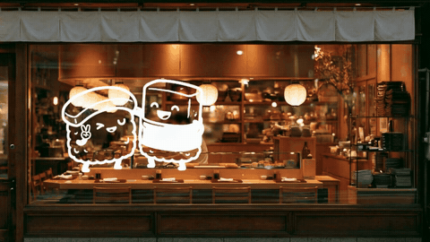
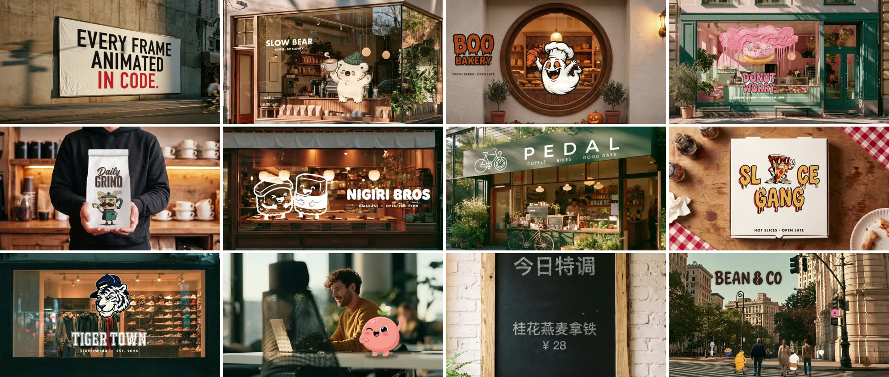

# mockup-motion · 样机动效

让实拍场景里的 2D 角色演一个 2–5 秒的小故事，最后亮出店名或 logo，出带音效的 MP4。

- **场景里活过来**：招牌、橱窗、海报、卷帘门、纸袋上的角色探头、一笔画出、滴落成形跑起来、跳进来吓一跳。
- **街头混入**：一群平面小怪混在真人里走，大怪从楼后探出来，镜头横移、往上摇。
- **全屏色块片头**：栏目片头、服务清单、频道 ID。

分工：场景和角色姿势用你手上的生图工具出（Midjourney、Nano Banana、GPT Image 都行），动画全部由代码完成。节奏是逐帧临摹参考片量出来的，不是 AI 视频，所以每一帧都可控、可改。

<p align="center">
  
  
</p>
<p align="center">
  
  
</p>



> 上面全部是代码逐帧渲染的，场景和角色姿势用生图工具出。

这是 [Claude Code](https://claude.com/claude-code) / Codex 的 skill：装好以后，直接用中文跟 agent 说你要什么就行。

## 安装

**Claude Code**
```bash
git clone https://github.com/linsahdkadsa/mockup-motion.git ~/.claude/skills/mockup-motion
```

**Codex**
```bash
git clone https://github.com/linsahdkadsa/mockup-motion.git ~/.codex/skills/mockup-motion
```

**或者用 skills 命令行**（会问你装到哪个 agent）
```bash
npx skills add linsahdkadsa/mockup-motion
```

**还需要两样**（第一次运行时 skill 会自己检查）：
- [uv](https://docs.astral.sh/uv/)：装好后，Python 依赖和 ffmpeg 会在第一次运行时自动下载。
- 一个 Chrome（Edge、Chromium 也行）。找不到时设置环境变量 `MM_CHROME` 指向浏览器程序，或运行 `uv run --with playwright playwright install chromium`。

**生图工具**：agent 要能调用一个生图工具（MCP 或 API 都行）来出场景和角色姿势。街头混入还要一个图生视频工具（比如海螺 H3、Seedance），用来出真人走动的底片。没有的话可以自己出图，放进文件夹给 agent 用。

## 怎么用

装好后重启 agent，直接说：

- 「给我的咖啡店 BEAN & CO 做个橱窗动画：小猫从窗沿探头，最后出店名」
- 「让这个 logo 在招牌上一笔画出来」（附上 logo）
- 「做一个 5 秒的街头片头：几只小怪混在行人里走，楼后探出一只大的，最后落店名」
- 「做个栏目片头，四段：视频、摄影、动效、空间」

agent 会先写一句话小故事给你确认，再出场景和角色、渲染，最后交付：
- `名字.mp4`：纯成片
- `名字_对照.mp4`：竖版对照，上面是成片，下面是原图
- 关键时刻的静帧和自检图

## 14 个模板

| 模板 | 一句话 |
|---|---|
| `peek` | 从窗沿探头 → 张望 → 蹦出来做表情 → 店名在招牌上弹出 |
| `draw-sign` | 招牌上一笔画出主角 → 店名弹出 → 眨眼 |
| `drip-run` | 一滴落下变成角色 → 长腿原地跑 → 名字跟着冒出 |
| `outline-loop` | 描轮廓 → 填色 → 出细节 → 循环享受 |
| `jump-react` | 跳进来落地 → 东西飞进来 → 吓一跳 → 聊、笑 |
| `carrier-reveal` | 卷帘门带着脸拉下来 → 一路眨眼 → 到底坏笑 |
| `splash-reveal` | 产品掉进来 → 泼到玻璃上往下流 → 字标弹出 |
| `carrier-hop` | 手里的袋子憋劲 → 弹跳两次 → 印的角色换表情 |
| `body-to-word` | 角色弹上来 → 字母顶替它的身体 |
| `slow-fast-letters` | 第一个词慢慢拼 → 角色掉进来甩头 → 第二个词一口气弹完 |
| `flipbook` | 角色原地跑，背景每 0.2 秒换一张实拍（翻页书） |
| `scribble-pop` | 线条甩出聚团 → 砰地变出角色 → 跳到真实桌面 → 招手 |
| `street-crowd` | 街头：大怪从楼后探出、小怪混在真人里走；落款镜头往上摇、字标弹出 |
| `color-panels` | 全屏色块：大字掉落 → 颜色板一段段推进来 → 拼回开场 |

详细的素材要求、参数和节奏见 `SKILL.md` 和 `references/`。

## 做不了的

- 液体形变、3D 角色、真实烟雾、镜头运动带出的透视变化（要靠 AI 视频）。
- 弯得厉害的曲面（杯身）按平面贴，会穿帮。

## 测试反馈

这是测试版，欢迎告诉我：
1. 你说了什么需求、用的哪个 agent 和生图工具。
2. 卡在哪一步：报错原文、哪句文档没看懂、要自己猜的数。
3. 成片哪里不对：穿模、比例、遮挡、节奏、落款位置。附上成片或截图最好。

## 许可

MIT，见 [LICENSE](LICENSE)。
